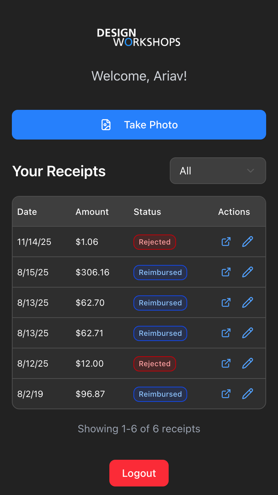
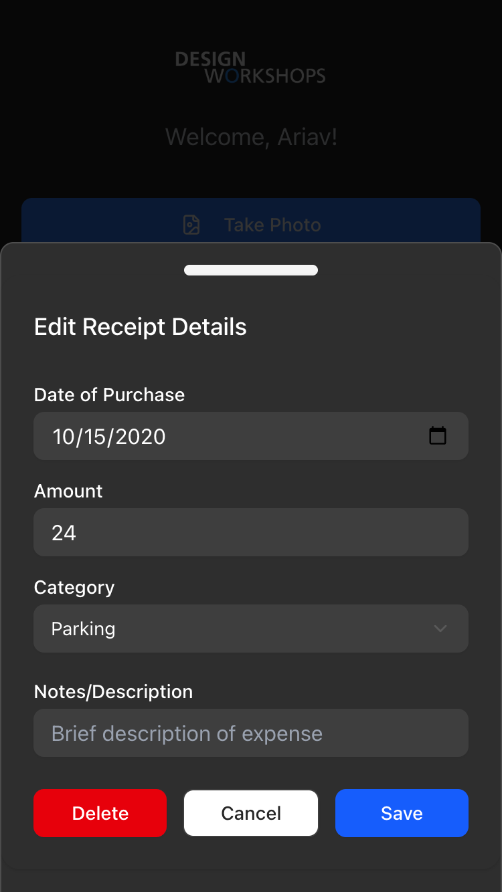

# Employee Features

[[README|← Back to Index]]

## Overview

Employees access `/employee` to submit receipts via mobile-first interface with camera integration and OCR auto-fill.



## Receipt Submission Flow

### 1. Capture/Upload

**Mobile**: "Take Photo" button triggers native camera or photo library

**Desktop**: "Upload Receipt" button opens file picker

**Supported formats**: JPEG, PNG, WebP, HEIC, PDF

### 2. File Processing

```
Selected → Validated → Uploaded to temp → OCR called
```

Size limits:
- Mobile: 50 MB
- Desktop: 10 MB

### 3. OCR Auto-Fill

AI extracts:
- **Date**: Purchase date in YYYY-MM-DD format
- **Amount**: Total including tax/tip
- **Category**: Parking, Gas, Meals & Entertainment, Office Supplies, Other

### 4. Auto-Submit Decision

If ALL conditions met:
- ✅ Date extracted
- ✅ Amount extracted
- ✅ Category resolved to ID
- ✅ No duplicate found

→ Auto-submits with success toast (includes "Tap to edit" link)

Otherwise → Opens confirmation form for manual entry.

### 5. Manual Confirmation

User reviews and can edit:
- Date (native date picker on mobile, calendar on desktop)
- Amount
- Category (dropdown)
- Notes/Description



Duplicate warning if matching date+amount exists.

## Mobile-First Design

### Platform Detection

```typescript
// Combines screen size + user agent
const isMobile = window.innerWidth < 768 || /iPhone|iPad|Android/.test(userAgent);
```

### Camera Integration

Mobile file input includes HEIC for iOS:
```html
<input type="file" accept="image/heic,image/jpeg,image/png,..." />
```

### Responsive Components

| Component | Mobile | Desktop |
|-----------|--------|---------|
| Receipt form | Bottom drawer | Center dialog |
| Date picker | Native `<input type="date">` | Calendar popover |
| Table text | text-xs | text-sm |
| Icons | 14px | 16px |

### Contextual Feedback

Distinguishes camera capture vs file selection:
- "Photo captured successfully" - recent file (< 30 sec) with camera name pattern
- "File selected successfully" - older file

## Receipt Table

### Columns

| Column | Mobile | Desktop |
|--------|--------|---------|
| Date | M/D/YY | Full date |
| Amount | $XX.XX | $XX.XX |
| Status | Badge | Badge |
| Actions | View, Edit | View, Edit |

### Status Badges

| Status | Color |
|--------|-------|
| Pending | Yellow |
| Approved | Green |
| Rejected | Red |
| Reimbursed | Blue |

### Filtering

Dropdown with options: All, Pending, Approved, Rejected, Reimbursed

### Pagination

- 10 items per page
- Smart ellipsis (shows first, last, current ± 1)

## Edit Restrictions

Employees can only edit **their own pending** receipts.

Attempting to edit processed receipt shows:
> "This receipt has been [status]. Please contact a system administrator."

## Key Files

| File | Purpose |
|------|---------|
| `app/employee/page.tsx` | Employee portal |
| `components/receipt-uploader.tsx` | Upload + OCR flow |
| `components/employee-receipt-table.tsx` | Receipt list |
| `components/receipt-details-card.tsx` | Edit form |
| `hooks/use-mobile.tsx` | Mobile detection |
| `lib/phone.ts` | Phone formatting |

## Error Handling

### Upload Errors

- File too large → Toast with size limit
- Invalid type → Platform-specific guidance (camera/library vs camera/gallery)
- Upload failed → Shows error, clears state

### OCR Errors

- Extraction fails → Opens form for manual entry
- Partial extraction → Shows form with available fields pre-filled

### Edit Errors

- Update failed → Toast with error message
- 403 error → Shows "Contact Admin" dialog

## Duplicate Detection

On form submit:
1. Checks for existing receipt with same date + amount
2. If found, compares notes/description
3. If description matches or both empty → Blocks with warning
4. If description differs → Allows submission

## Profile Auto-Creation

First login without profile creates default:

```typescript
{
  user_id: session.user.id,
  role: 'employee',
  full_name: session.user.phone  // Placeholder
}
```

## DWS Photos

The photo app shares the sign-in and the Users page with Receipts. The words
employees see are **Project**, **Album**, and **Tag**; `job` in code means project.

### Starting the app

Signing in on the photos address, or opening its root, lands on **Projects**.
The photo library has its own home-screen icon, a blue tile with a photo on it
called "DWS Photos", and opens on Projects from it. On an iPhone: open the site
in Safari, Share, **Add to Home Screen**. A shortcut added before this icon
existed keeps the receipts icon; remove it and add it again.

### Browsing

Every photo grid (Photos, a project, an album, search) has one toolbar row:
**Filter**, **Group by**, and **Sort**.

- **Filter** opens a sheet on the phone and shows inline chips on desktop:
  Project (Photos and search only), Uploader, Tags (several, all must match),
  File type (JPEG, HEIC, PNG, RAW, Video, Other), and Date (This week, This
  month, This year, or a custom range). Active filters show as removable chips
  under the toolbar with **Clear**. When nothing matches, the grid says "No
  photos match" with a **Clear filters** button.
- **Group by** Date, Tag, Uploader, or File type (search adds Project). A
  project opens grouped by Tag; Photos, albums, and search open by Date.
- **Sort** Newest or Oldest. An album with a saved order also offers **Custom**.
- Filters, grouping, and sort live in the page URL, so a reload or a shared
  link keeps them.
- **Search** splits what you type into words, and every word has to match a
  project number or name, an uploader name, a tag, or a photo's name. So
  `3962 professional` finds photos in project 3962 tagged professional.

### Favorites

Open any photo and tap the heart in the viewer (or **Add to favorites** in its
details) to keep it in **Favorites**, the fourth section beside Photos, Albums,
and Projects. Favorites are personal: only you see your hearts, and nobody
else's hearts show for you. A small heart in the corner of a tile marks your
favorites in every grid. Favorites opens grouped by project, with the usual
filters, select-many, Download, and slideshow. Select photos and press
**Favorite** to heart several at once; on the Favorites page the same button is
**Unfavorite**. A favorite stays through Trash and restore, and goes with the
photo when it is deleted forever.

### Selecting many

Long-press (phone) or click the tick (desktop) to start a selection. The bar
reads "N selected · Select all M"; **Select all** picks every photo that matches
the current filters, loaded or not, up to 5,000 ("Select all 5,000 (of M)" past
that). A group header's tick selects the whole group the same way. Tag and
Add to album work in slices of 500 behind one progress toast; Set project goes
through the confirmation page as one batch, and Trash moves the photos at once
with an Undo.

**Tag** has two modes, **Add tags** and **Remove tags**. To take a tag off
photos it was given by mistake: Group by Tag, tick that tag's group header,
press Tag, choose Remove tags, pick the tag, and press Remove tag. A single
photo's tags are edited from **Edit tags** in its details.

### Download

**Download** in the selection bar builds one zip in the browser. A confirmation
shows the count and total size first, warns above 2 GB, and on a phone says
large downloads work best on a computer. Entries are named with each photo's
display name plus its original extension; duplicates get " (2)", " (3)". If any
photo could not be fetched, the toast names it and never calls the zip complete.

### Viewer and slideshow

Photos open edge to edge. One tap or click hides every control (toolbar,
counter, arrows, thumbnails, Details); another brings them back. On desktop,
Details is an **i** button, off by default, and **Fullscreen** appears where the
browser supports it. **Play** in the viewer or in a project, album, or search
page header starts a slideshow of that page's photos in its current order: 4 s
each, looping, photos only. Any tap pauses it.

### Arranging an album

**Arrange** on an album page (2 or more photos, up to 2,000) enters a drag mode:
long-press and drag on the phone, click and drag on desktop, with **Done** and
**Cancel**. The saved order is what everyone sees, including the share link and
the slideshow. Photos added later go last. Choosing Newest or Oldest on an
arranged album puts it back in date order for everyone (the toast offers Undo);
choosing Custom again restores the saved order.

### Names

A photo's name is automatic: `<project number> – <YYMMDD> <HHMMSS>` from its
capture time (Pacific), or `<YYMMDD> <HHMMSS>` without a project, with " (2)",
" (3)" for the same second. Moving a photo to another project renames it.
Renaming by hand keeps that name; renaming to blank goes back to automatic. The
original filename stays under "About this file", and downloads use the display
name plus the original extension.

### Deleting

Anyone can trash a photo they uploaded in the last 30 days, restore any trashed
photo, and delete an album they created. A **photo admin** (a checkbox on the
Users page, separate from the Receipts role) can trash any photo, delete
forever, empty the Trash, and delete any project or album. The buttons only
appear when allowed; a mixed selection reads "Trash the N you can delete".

### Previews for every photo

Your browser makes each photo's thumbnail and preview while it uploads. When it
cannot — an iPhone HEIC picked on a desktop browser, a TIFF, an image over
24 MB, a video the browser cannot play — the server makes them as soon as the
upload lands, so the photo has a preview by the time the tray says done. There
is no upload size limit; a file the server cannot read either (a RAW file, an
image over 250 MB) shows as a "No preview" tile that still downloads. A photo
that somehow missed both gets its preview from the nightly sweep.

Videos upload at any size too. The poster frame comes from your browser when it
can play the clip, otherwise from the server (clips up to 200 MB). Playing a
clip in the app depends on the browser: an iPhone's HEVC .mov plays on iPhones
and Macs, and a Windows browser may only offer it for download. The nightly
sweep makes a standard MP4 copy of clips up to 200 MB and 2 minutes so they
play everywhere; longer or larger clips stay download-only.

### Other formats of the same photo

Uploading `IMG_1234.CR2` into a project that already holds `IMG_1234.JPG` with
the same capture second pauses that file: "Looks like another format of
IMG_1234.JPG", with **Keep** to upload it anyway. The folder import has one
"Keep other formats" switch per batch; left off, such files are listed as left
out. Live Photo videos are not treated as another format of their photo.

## Related Pages

- [[Receipts]] - Upload and OCR details
- [[Authentication]] - Login flow
- [[API]] - Endpoint reference
- [[Components]] - UI components used
- [[photos-runbook]] - Operator notes for DWS Photos
