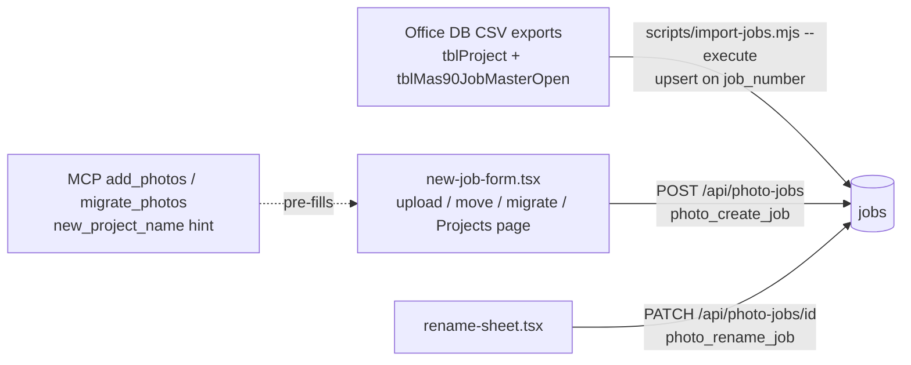
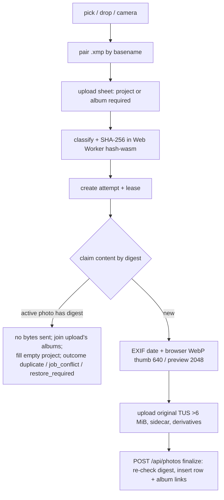

# Research: DWS Photos as it exists at `53dd82f`

**Date**: 2026-09-24T17:31:18-07:00
**Git Commit**: `53dd82f109720a74cf40a303b3e704866dac69c7` (on `origin/main`)
**Branch**: `ariavasulin/plan-dws-photos-client-feedback`
**Repository**: ariavasulin/OpenReimbursements

Paths are relative to `dws-app/` unless they start with `Docs/` or `plans/`. Permalink base:
`https://github.com/ariavasulin/OpenReimbursements/blob/53dd82f109720a74cf40a303b3e704866dac69c7/dws-app/<path>#L<line>`.

## Research Question

The fourteen questions in [`research-questions.md`](research-questions.md):

1. Photo data model (jobs, photos, albums, album_photos, tags, content claims, share links; required project; number/name storage; uploader, times, names, file type; soft-delete and purge columns).
2. Where jobs (projects) come from, including any outside source of job numbers or names.
3. Roles and permission to change photos, per operation, and how admins are made.
4. Trash and permanent deletion end to end, including bulk purge, 30-day expiry, and wipe procedures.
5. Tags: storage, normalization, scope, and ordering.
6. Selection and bulk operations per surface, including download/export.
7. Grouping, sorting, and album order.
8. Upload identity and duplicates; accepted file types.
9. Capture metadata and file naming.
10. Viewing a photo.
11. Search.
12. Albums.
13. Photos UI design system.
14. Test and release surfaces.

## Research Methodology (verbatim)

This document will remain objective and factual. It does not contain any recommendations or implementation suggestions.
Open questions will not ask Why things haven't been built or what should be built in the future.

There is no "implementation" section - that is intentional.

## Summary

DWS Photos is a section of the Next.js 15 app (`src/app/photos`, `src/components/photos`, `src/lib/photos`) backed by Supabase Postgres and a **public** Storage bucket named `photos`. Every write goes through a route handler that calls `requirePhotoActor` and then a `security definer` SQL function callable only by the service role; both layers check the caller is a signed-in, active `employee` or `admin` and that the `photo_release_state.photo_writes_enabled` switch is open. For photos, the role makes no difference: since the photo-albums plan (Decision 7, 2026-09-20) and the 2026-09-23 "manage and purge" migration, **any active employee can trash, restore, delete forever, and empty the trash**, and can create, rename, delete, and share any project or album. Only operator deployment functions still require `role='admin'`. No rule restricts anyone to their own uploads or to a time window.

A **project** is a `jobs` row with a unique, required `job_number` and a free-text `name`. A photo has zero or one project (`photos.job_id` became nullable in the albums migration) and any number of **albums** (flat many-to-many via `album_photos`, which has no position column). **Tags** are a `text[]` on each photo; the suggestion list is global, built on the fly from every active photo's tags plus three hard-coded starter tags. Jobs came into the database once, from `scripts/import-jobs.mjs`, which reads CSV exports of the office database (`tblProject`, `tblMas90JobMasterOpen`); there is no live sync. Employees can also create projects by hand (`P-<n>` codes when no number is typed) and rename or renumber any project.

Uploads are identified by a full-file **SHA-256** computed in the browser. Identical bytes are caught before transfer, and the existing photo is reused (joined to the upload's albums). Nothing compares by file name, EXIF, or visual similarity, so a JPEG and a RAW of the same shot are two photos. Capture time comes from EXIF `DateTimeOriginal`/`CreateDate` via `exifr` (no sub-seconds, no offset, no camera model), falling back through XMP, camera shutter time, file modified time, then upload time. The storage key is `originals/<uploader>/<photoId>/<sanitized original name>`; people see `display_name` if set, else `original_name`. There is no automatic naming scheme other than `IMG_<ms>_<n>.jpg` for in-app camera shots.

Every photo grid (Photos, project, album, search) is one component, `PhotoBrowser`, fed by `GET /api/photos`, which always orders by `captured_at desc, id desc` in pages of 100. Grouping (Date, Tag, and Project on search only) happens in the browser over loaded pages; there is no sort control. Search is one substring matched against project number/name, uploader name, or tag (OR); filters and group-by are not in the URL. Select-many (up to 500) exists on all grids with Add to album, Tag (add only), Set project, Trash, and Rename (one photo). There is no bulk download or zip anywhere. The viewer is `yet-another-react-lightbox` with Zoom, Video, Counter (plus Inline and Thumbnails on desktop); a fixed Details panel on desktop, a Details pop-up on phone; no Slideshow or Fullscreen plugin. The photo UI is dark-only with hex colors hard-coded in Tailwind classes.

## Detailed Findings

### 1. Photo data model

Latest-migration shape of the photo tables:

| Table | Key columns | Uniqueness / indexes | Soft-delete / purge |
|---|---|---|---|
| `jobs` | `id`; `job_number text not null unique`; `name text not null`; `location`; `is_active bool default true`; `synced_at` (`supabase/migrations/00000000000003_photos_schema.sql:3-10`); `created_by`, `created_at` (`20260920214954_photo_job_projects.sql:7-8`) | `jobs_job_number_key`; check `jobs_deleted_not_active` (`20260923180000_photo_manage_followups.sql:18-22`) | `deleted_at`, `deleted_by`, `purged_at` (`20260923120000_photo_manage_and_purge.sql:44-49`); on purge `job_number` becomes `'deleted:'||id` (`20260923180000_photo_manage_followups.sql:137`) |
| `photos` | `job_id` → jobs **nullable** (`20260921024651_photo_albums.sql:32`); `uploader_id` not null; `kind` image/video/file; `tags text[]`; `captured_at` not null + `captured_at_source` exif/xmp/camera/file/upload; `original_path`, `original_name`, `original_bytes`, `mime_type`; `thumb_path`, `preview_path`, `playback_path`, `sidecar_path`, `sidecar_name`; `content_sha256`; `display_name` (`20260923120000_photo_manage_and_purge.sql:18`); `created_at` = upload time | GIN on tags; keyset indexes on `(job_id, captured_at, id)`, `(captured_at, id)`, `(uploader_id, captured_at, id)` (`20260822120100_add_photos_indexes.sql:11-29`); content hash unique per project (`photos_job_sha`) or library-wide (`photos_content_sha256`) after the identity cutover (`20260907180000_photo_identity_cutover.sql:183-185`) | `deleted_at`, `deleted_by`, `purge_after` (= deleted_at + 30 days, check `photos_trash_consistent`), `purge_claimed_at` (`20260907100000_hosted_photo_schema.sql:19-21`); purged rows are deleted |
| `albums` | `name` 1–120 chars, not unique; `created_by`, `created_at`, `updated_at` (`20260921024651_photo_albums.sql:37-46`) | — | `deleted_at`, `deleted_by`, `purged_at` |
| `album_photos` | PK `(album_id, photo_id)`; `added_by`, `added_at` (`20260921024651_photo_albums.sql:49-55`) | `album_photos_photo` | none; rows removed on album purge or photo delete (cascade) |
| tags | no table; `photos.tags`; max 20 tags × 64 chars (`src/lib/photos/apiShared.ts:37-38`) | GIN | — |
| `photo_content_claims` | PK `content_sha256`; one of `migration_item_id`/`upload_attempt_id`; lease columns (`20260907100000_hosted_photo_schema.sql:116-123`) | PK | short-lived, hard-deleted |
| `photo_share_links` | `token` (43-char base64url); one of `album_id`/`job_id` (`20260921040000_photo_share_links.sql:31-46`) | one live link per album/job | `revoked_at`, `revoked_by` |

Name rules: a project name collapses whitespace, trims, 1–120 chars (`photo_job_name`, `20260920214954_photo_job_projects.sql:12-18`); a typed number is trimmed, ≤32 chars, and may not start with `P-` (`photo_job_number`, `20260923180000_photo_manage_followups.sql:46-53`). Nothing enforces that office numbers are digits (`scripts/import-jobs.mjs:61` copies `JobNo` as-is), although `Docs/photos-runbook.md:139-140` states they are. No "misc" or events convention exists anywhere in code, docs, or plans; the MCP photos skill tells assistants that photos belonging to no office job (for example a holiday party) get no project (`src/lib/mcp/harness/skills/photos/SKILL.md:37-39`).

An upload must name a project, at least one album, or both (`20260921024651_photo_albums.sql:135`, `src/lib/photos/server/uploads.ts:58-60`); after upload, a photo can be set to "No project".

#### Testing patterns
`integration/db/jobs.test.ts`, `integration/db/manage.test.ts`, `integration/db/albums.test.ts`, `integration/db/uploads.test.ts` run against a throwaway local Supabase in Docker (`npm run test:db`). `tests/browser/no-project.spec.ts` covers project-less photos in the UI.

### 2. Where projects come from

- **Office import (the only outside source).** `scripts/import-jobs.mjs` is a "one-time import of active jobs from the office DB CSV dumps" (`:2-4`). It joins `tblProject` (`ProjectID`, `Project`, `Location`, `Archived`) to `tblMas90JobMasterOpen` (`JobNo`, `JobStatus`), keeps open, non-archived rows, and with `--execute` upserts `{job_number, name, location, is_active, synced_at}` keyed on `job_number` (`:60-123`). It skips numbers held by a project in Trash (`:96-114`). An office row therefore overwrites a same-numbered hand-made or renamed row's name (`Docs/photos-runbook.md:160-166`, which calls reconciliation "undecided"). `synced_at` is the only provenance marker. No cron, API, or scheduled sync exists; the script has no tests. The photo-folders plan records 22 production jobs from this import.
- **Hand-made.** `POST /api/photo-jobs` → `photo_create_job` (`src/app/api/photo-jobs/route.ts:54-65`; `20260923120000_photo_manage_and_purge.sql:82-101`). A blank number gets `P-<n>` from `job_project_code_seq`; a live duplicate number returns the existing project (`exists`); a number held in Trash is refused (`job_in_trash`). The one creation form is `new-job-form.tsx`, which shows "Already exists" matches as you type (`:38-42,64-79`) and is used by the job combobox, the move page, `/migrate`, and the Projects page.
- **Rename/renumber.** `PATCH /api/photo-jobs/[id]` → `photo_rename_job` changes name and optionally number (`20260923180000_photo_manage_followups.sql:58-74`); UI `rename-sheet.tsx` from the Projects page and project header.
- **MCP** never creates projects; `job_number` and `new_project_name` are suggestions confirmed in the browser (`src/lib/mcp/registry.ts:27-30`).
- **Folder import** suggests a project when a folder name contains an existing project number (≥3 chars) as a whole word (`src/lib/photos/migration/folders.ts:86,115-145`).
- **Pickers.** `GET /api/photo-jobs?q=` returns active jobs matching number or name by substring, ordered latest upload first (`get_photo_job_summaries`, `20260907100410_photo_active_reads.sql:3-54`). Client ranking in `src/lib/photos/job-filter.ts:4-43`: exact number, number prefix, word prefix, substring.

#### Testing patterns
Unit: `src/lib/photos/job-filter.test.ts`, `src/lib/photos/migration/folders.test.ts`. DB: `integration/db/jobs.test.ts`, `integration/db/manage.test.ts:73-146` (renumber; simulated import upsert against Trash). Routes: `integration/routes/jobs.test.ts`, `integration/routes/manage.test.ts:75-83`. Browser: `tests/browser/projects.spec.ts`. No component tests for the forms.

### 3. Roles and permissions

`user_profiles.role` is `'employee'` (default) or `'admin'` by CHECK constraint (`supabase/migrations/00000000000000_baseline.sql:294,301`); no other role exists. Employees can update only their own `full_name` (`20260823100000_review_fixes.sql:128-138`). Admins are made in the Users page (`src/app/users/page.tsx`, role select in `src/components/user-form-modal.tsx:223-236`) through `POST`/`PATCH /api/admin/users[/id]` behind `requireAdmin()` (`src/lib/requireAdmin.ts:11-42`); `scripts/onboard-users.mjs:147-151` always writes `employee`.

`requirePhotoActor` (`src/lib/photos/server/authority.ts:17-47`) checks same-origin, a verified non-anonymous user, a live profile with role employee **or** admin, the SQL `photo_require_actor` (not deleted, not banned), and the release switches. Reads use `requirePhotoReader` (session only, `src/lib/photos/server/reads.ts:27-32`).

| Operation | Allowed today | Where enforced |
|---|---|---|
| Upload | any active employee; Storage writes limited to own `originals/<uid>/`, `derived/<uid>/` | route + `photo_finalize_upload` + Storage RLS |
| Edit tags, rename photo, bulk tag | any active employee | route + SQL / session `update(tags)` grant |
| Move to project / No project | any active employee; confirm batch creator must approve and apply | route + `photo_assert_batch_actor` |
| Trash / restore photo | any active employee | route + `photo_apply_action` (uploader check removed, `20260920234821_photo_open_trash_authority.sql:1-29`) |
| Add/remove album membership; create/rename/delete/restore album | any active employee | route + SQL |
| Create/rename/renumber/delete/restore project | any active employee | route + SQL |
| Delete forever / Empty trash | any active employee | `src/app/api/photos/trash/purge/route.ts:19-47` + `photo_purge_*` (header: "Any signed-in employee may do all of this, including deleting forever (owner's decision, 2026-09-23)", `20260923120000_photo_manage_and_purge.sql:11-12`) |
| Share link on/off | any active employee | route + `photo_share_set` |
| Folder import | any active employee starts; only its creator changes it | route + SQL |
| MCP photo scripts | the employee who consumes the one-use hand-off | MCP key + `mcp_enabled` + hand-off binding |
| Write-boundary installer, identity cutover | **admin only** | SQL `role='admin'` checks |

Before 2026-09-20, `20260907100400_photo_actions.sql:31,48-50,76` limited trash/restore to the uploader or an admin. `plans/active/photo-albums/plan.md` Decision 7 opened it and lists "re-add the uploader check" as a first-release reversal; its Risks section names "Anyone can bulk-trash". The only time limits in the system are the 30-day restore window, 30-minute MCP hand-offs, and 2-minute upload leases.

#### Testing patterns
DB: `integration/db/authority.test.ts:80-90` asserts only deployment tools check `role='admin'`; `integration/db/actions.test.ts:17` (any employee trashes a colleague's photo). Routes: `integration/routes/authority.test.ts:111-131`. Browser: `tests/browser/photo-actions.spec.ts`. No unit test for `authority.ts`.

### 4. Trash and permanent deletion

```mermaid
stateDiagram-v2
  [*] --> Active
  Active --> Trashed: trash photo / delete project\n(deleted_at, purge_after = +30d)
  Trashed --> Active: restore (before purge_after)
  Trashed --> Marked: Delete forever / Empty trash\n(purge_claimed_at)
  Trashed --> Marked: daily cron, purge_after <= now\n(repair_enabled on)
  Marked --> Gone: Storage delete verified -> row deleted,\nid retired, album_photos cascade
  state "Project / album deleted" as PA
  Active --> PA
  PA --> Active: restore within 30 days
  PA --> Tombstone: Delete forever / Empty trash\n(purged_at; album_photos removed;\nshare links revoked)
```

- **Trash a photo** sets `deleted_at`, `deleted_by`, `purge_after`; files and album memberships remain, memberships hidden by RLS (`20260921024651_photo_albums.sql:70-72`).
- **Delete a project** (`photo_delete_job`, `20260923180000_photo_manage_followups.sql:79-95`) sets `deleted_at`, `is_active=false`, and trashes all its active photos with the same timestamp; restore brings back exactly those. **Delete an album** sets only `deleted_at`.
- **Trash page** (`src/app/photos/trash/page.tsx`) lists trashed photos (50 per page, checkboxes, "Select all on this page"), every deleted project (any age), and albums deleted in the last 30 days. Buttons: per-item Restore / Delete forever, "Delete N photos forever", **"Empty trash"** (`{everything:true}`, `:115-124`), and "Finish deleting" when a purge is incomplete. The page says "Anyone signed in can restore, or delete forever" (`:114`).
- **Purge route** marks items (`photo_purge_request`, up to 500 ids per kind or `everything`; revokes share links; tombstones jobs/albums), then for up to 45 s deletes each photo's Storage paths (original, thumb, preview, sidecar, playback) only when no other live owner uses the path, verifies, and deletes the row (`src/lib/photos/server/purge.ts:44-72`; `20260923120000_photo_manage_and_purge.sql:317-359`). The client repeats while `remaining > 0` (`src/lib/photos/api.ts:325-342`).
- **Automatic 30-day expiry** is the daily repair cron (`vercel.json`, `0 9 * * *` UTC), gated by `CRON_SECRET` and `repair_enabled`; it purges photos only. Projects and albums are never auto-purged. It also deletes Storage orphans older than 24 h (`src/lib/photos/repair/run.ts:155-182`).
- **Wipe procedure.** `Docs/photos-runbook.md:86-92` "Wiping the library": delete each project, trash remaining project-less photos (500 at a time), delete each album, then Empty trash. Stopping a running delete requires closing `photo_writes_enabled` (`:84-85`). No SQL or script resets photo data; no script in `scripts/` deletes photos.
- Production row counts were not queried in this research (the Supabase CLI is logged in but this checkout is not linked). The photo-albums plan recorded 41 photos in one project on 2026-09-20; later PRs (#20, #21) shipped since.

#### Testing patterns
DB: `integration/db/manage.test.ts:94-310` (project delete/restore, delete forever, `everything`). Routes: `integration/routes/manage.test.ts:84-146`, `integration/routes/repair.test.ts`. Unit: `src/lib/photos/repair/*.test.ts`; none for `purge.ts`. **No browser test covers Delete forever or Empty trash.**

### 5. Tags

Tags are `photos.tags text[]`; no tag table (photo-albums Decision 5, which names a tag table as a later option "only if renaming or merging tags becomes a real request"). The vocabulary is **global**: `get_photo_tags(job_filter, q)` returns distinct tags over all active photos, optionally limited to one project, sorted alphabetically, case-sensitive distinct, unbounded (`20260907100410_photo_active_reads.sql:58-76`; `20260823120400_photo_tags_unbounded.sql:1`). `/api/photo-tags?job=&q=` exposes it.

In the browser, `tagChoices` merges in-use tags with starter tags `professional`, `field dimension`, `shop drawing`, dedupes ignoring case, sorts A–Z (`src/lib/photos/tags.ts:29-48`); `tagMenu` narrows by substring and offers `Add "<typed>"` (`:68-77`). `tag-dropdown.tsx` is the one picker (upload, Edit details, bulk Tag); it always uses the global list, even on a project page. `tag-input.tsx` is unused.

The Tag **filter** differs by page: all tags on Photos, that project's tags on a project page, only loaded photos' tags on album and search pages (`src/components/photos/photo-browser.tsx:165-171`).

Normalization differs by write path: bulk tag (`photo_bulk_tag`) and import (`migration_folder_update`) map to the most common existing spelling ignoring case on the server; single-photo PATCH and upload only trim/dedupe exact case (`cleanTags`, `src/lib/photos/apiShared.ts:41-51`), relying on the dropdown. Folder names become albums, not tags; per-folder tag choices live in `migration_folders.tags`.

#### Testing patterns
Unit: `src/lib/photos/tags.test.ts`, `filter-options.test.ts`. DB: `integration/db/albums.test.ts:392`, `integration/db/import-albums.test.ts:264-360`. Browser: `tests/browser/albums-ui.spec.ts:294` (dropdown, filter, group by tag).

### 6. Selection and bulk operations

Selection state is `usePhotoSelection` (`src/hooks/use-photo-selection.ts:20-73`) over rules in `src/lib/photos/selection.ts` (limit 500, shift-range in display order, group toggle `:65-76`). Phone: press-and-hold 450 ms; desktop: hover tick and shift-click; each group header has "Select all of <label>" (`src/components/photos/photo-grid.tsx:51,95-172,340-364`). A group tick covers only the **loaded** part of the group (pages of 100).

| Surface | Select many | Bulk actions |
|---|---|---|
| Photos, project page, search | tiles, range, group tick | Add to album (new or existing, several), Tag (**add only**), Set project (via confirm page), Trash (via confirm page), Rename (exactly 1) |
| Album page | same | same + Remove from album |
| Projects list, Albums list | "Select" mode on cards (`src/hooks/use-collection-select.ts`, `collection-select-bar.tsx`) | Rename (exactly 1), Delete (any number; project delete trashes its photos). No select-all. |
| Trash | photo checkboxes, select all on page (50) | Delete forever; Empty trash. Restore is per photo. |
| Share page `/s/<token>` | none | per-photo download in viewer |

Not available anywhere: bulk tag removal (API supports `remove`, UI never sends it), capture-date editing (single PATCH accepts only `tags` and `display_name`, `src/app/api/photos/[id]/route.ts:29`), bulk restore, bulk download, zip. No zip library is installed. Downloads are per file: "Download original"/"Download XMP" in the details panel, file-tile icon, unplayable-video card, share viewer. `src/lib/photos/batch.ts` and `batch-preview.tsx` are upload-queue helpers, not bulk actions.

The confirm page `/photos/actions` (`src/components/photos/photo-actions.tsx`) handles move, trash, restore batches: materialize, show 50 per page, approve and apply in chunks, with per-photo leave-out and undo.

#### Testing patterns
Unit: `src/lib/photos/selection.test.ts`. Browser: `tests/browser/albums-ui.spec.ts:339,496` (every bar action; 500 limit), `photo-actions.spec.ts:39`. No browser test for Projects/Albums list Select mode.

### 7. Grouping, sorting, and album order

`GET /api/photos` accepts `job, album, tags, uploader, q, cursor, limit` and always orders `captured_at desc, id desc`, keyset-paged, 100 default / 200 max (`src/app/api/photos/route.ts:113-197`; `src/lib/photos/apiShared.ts:13`). There is **no sort or direction parameter and no sort control** on any surface.

`src/lib/photos/group.ts` groups loaded photos in the browser:
- **Date**: local calendar day, first-seen order (newest day first); "Unknown date" for unparseable.
- **Project** (`job`): `#number · name`, first-seen; "No project".
- **Tag**: a photo appears under each of its tags; A–Z ignoring case; "No tags" last.
- Photos inside any group keep `captured_at desc`.

| Surface | Modes (default first) |
|---|---|
| Photos | Date, Tag |
| Project page | Date, Tag, plus pinned "professional" row when grouped by date with no filter (`photo-grid.tsx:302-333`) |
| Album page | Date, Tag |
| Search | Project, Date, Tag |
| Projects / Albums lists, sidebar | none |

The mode is `useState` in `photo-browser.tsx:110`, not in the URL. There is no "Uploader" or "File type" mode. Group headers show "· N photos" except in Date mode.

**Album order**: `album_photos` has **no position column**; album pages use the same `captured_at desc` order (not `added_at`). The albums list orders by most recently added-to (`get_photo_album_summaries`, `20260921024651_photo_albums.sql:527-547`); the projects list by latest **upload** (`max(photos.created_at)`) then number descending. Collection lists are fully fetched then split client-side (60 per Albums page, 100 in the sidebar). `react-photo-album` is installed but **not imported anywhere**.

#### Testing patterns
Unit: `src/lib/photos/group.test.ts`, `src/lib/keysetCursor.test.ts`, `collectionPagination.test.ts`. Routes: `integration/routes/albums.test.ts:397-440`. Browser: `tests/browser/albums-ui.spec.ts:294-337` (group by tag). No test for Project mode in the browser, the pinned row, or grouping across pages.

### 8. Upload identity, duplicates, and file types

- "Same" means **byte-identical SHA-256** of the whole file (`src/lib/photos/hash-core.ts:4-21`; `photo_same_photo_outcome`, `20260921024651_photo_albums.sql:101-116`). No filename, EXIF, or perceptual matching exists; `sharp` is used only by receipts. A re-encoded or differently formatted copy (JPG vs RAW vs HEIC) is a new photo.
- The user sees "N photo(s) already in Photos" (toast), "already in this project / already in Photos, added to the album" (tray), and "Review move / Review restore" for conflicts (`src/lib/photos/upload-manager.tsx:306-314`; `src/components/photos/upload-tray.tsx:36-146`). `/migrate` shows "Already in DWS Photos / In another project / In trash".
- `/api/photos/exists` and `/api/photos/dedupe` are **not called by app code**; only tests use them.

| Extension | Kind | Browser preview | Nightly repair preview |
|---|---|---|---|
| jpg, jpeg, png, webp, gif | image | canvas WebP if ≤24 MB | Supabase transform (jpeg/png/webp ≤25 MB); gif becomes a file tile |
| heic, heif | image | only if browser decodes (not Chrome) | Supabase transform ≤25 MB |
| tif, tiff | image | skipped (treated as raw) | Supabase transform |
| dng, cr2, nef, arw | image | skipped | not transformable → file tile |
| cr3 | image or file depending on browser MIME | decode attempted, fails with warning | file tile |
| mov, mp4, m4v, 3gp, webm | video | poster ~1 s + duration | ffmpeg poster; MP4 only with `PHOTOS_TRANSCODE=1` |
| xmp | sidecar | — | — |
| other | file | — | — |

Sources: `src/lib/photos/classify.ts:17-60`, `decode-limits.ts:3-13`, `derivatives.ts:9-149`, `repair/sweep.ts:44-104`.

#### Testing patterns
Unit: `hash.test.ts`, `upload*.test.ts`, `classify.test.ts`, `derivatives.test.ts`, `video-source.test.ts`. DB: `integration/db/uploads.test.ts`, `import-albums.test.ts`. Routes: `integration/routes/uploads.test.ts:319-335`. Browser: `tests/browser/photo-actions.spec.ts:99`, `import-albums.spec.ts:157`.

### 9. Capture metadata and file naming

`readExifDate` calls `exifr.parse(source, ["DateTimeOriginal","CreateDate"])` (`src/lib/photos/exif.ts:44-49`) for `image/*` only, discarding dates before 1990 or after now+24h. EXIF is skipped for files over 16 MB and for tif/tiff/dng/cr2/nef/arw (`src/lib/photos/upload.ts:282-285`). Not read: `SubSecTimeOriginal`, `OffsetTimeOriginal`, Make, Model. Fallback order: EXIF → XMP sidecar date → in-app camera shutter → file `lastModified` → null, which the server stores as upload time with source `upload` (`exif.ts:67-80`; `20260921035400_photo_import_albums.sql:389-391`).

`exifr` behavior (library docs): officially parses JPEG, TIFF, PNG, HEIC, AVIF, IIQ; RAW support beyond TIFF-based formats is undocumented; with default `reviveValues` it builds a JS `Date` in the **runtime's local time zone**, so the same file can map to different instants on machines in different zones ([README](https://github.com/MikeKovarik/exifr), issues [#51](https://github.com/MikeKovarik/exifr/issues/51), [#90](https://github.com/MikeKovarik/exifr/issues/90)).

Naming:
- Storage key: `originals/<uploader>/<photoId>/<photo_storage_filename(original_name)>` (NFKD, non `[A-Za-z0-9_-]` → `_`) (`20260907100100_hosted_photo_authority.sql:86-95`; `20260921024651_photo_albums.sql:141-144`). Derivatives `derived/<uploader>/<photoId>_thumb.webp` / `_preview.webp`.
- `original_name` = picked file name, never changes (MCP and imports match on it).
- `display_name` = human rename (1–200 chars, no slashes), set via Rename; `photoName` shows it else `original_name` (`src/lib/photos/format.ts:24-26`).
- In-app download uses `downloadName` = display name + original extension via Supabase `?download=` (`src/lib/photos/urls.ts:17-24`; `format.ts:32-38`). Share-link downloads use `original_name` (`src/lib/photos/server/sharing.ts:85-88`), contrary to `Docs/photos-runbook.md:121-124`.
- Camera shots: `IMG_<epochMs>_<n>.jpg` (`src/components/photos/multi-shot-camera.tsx:160-164`). No other automatic naming exists.

#### Testing patterns
Unit: `exif.test.ts` (full fallback order), `sidecar.test.ts`, `format.test.ts:5-11`. Routes: `integration/routes/manage.test.ts:67-73` (rename). No test for download filenames in the browser.

### 10. Viewing a photo

`src/components/photos/photo-lightbox.tsx` wraps `yet-another-react-lightbox`. Shared settings: Zoom (`maxZoomPixelRatio: 4`), wrap-around, black background, custom "unplayable" video slide (`:422-438`). Image slides are `{src: previewUrl}` — the 2048 px WebP preview, no `srcSet`, default `imageFit` (contain). `useDesktop()` = width ≥1024 px **and** hover pointer (`src/hooks/use-desktop.ts:9`).

- **Phone** (`:519-563`): YARL overlay at z-40 with Zoom, Video, Counter; toolbar is a "Details" pill and Close; Details opens a bottom drawer with `PhotoInfo`. Nothing is drawn over the photo. No setting hides the toolbar or counter.
- **Desktop** (`:440-517`): full-screen `bg-black/95` dialog; YARL Inline + Zoom, Video, Counter, **Thumbnails** strip on the left; fixed 340 px Details `<aside>` on the right, always visible, no collapse. The viewer covers the top bar and rail. It re-implements focus trap, inert background, scroll lock, Escape, and click-outside-to-close.
- **Details panel** (`photo-info.tsx`): name (inline rename), project, album pills, tags, taken date/uploader/file info; actions Download original, Download XMP, Rename, Edit details, Set project, Copy link, Move to trash.
- Deep links: `?photo=<id>` synced by `use-photo-deep-link.ts`.
- **No Slideshow or Fullscreen plugin** is imported; no timed advance exists. `shared-gallery.tsx` (public `/s/<token>`) is a separate hand-written viewer with `object-contain`, prev/next, download, no zoom, no swipe, no wrap.

Library facts ([YARL docs](https://yet-another-react-lightbox.com/documentation)): official plugins include Slideshow (`autoplay`, `delay` default 3000 ms, play/pause button, `ref.play()`), Fullscreen, Thumbnails, Captions, Counter, Download, Share, Zoom, Video, Inline. There is **no built-in hide-controls-on-tap/idle**; the maintainer's pattern is a state-driven class plus CSS ([discussion #324](https://github.com/igordanchenko/yet-another-react-lightbox/discussions/324)). The Fullscreen plugin hides itself where the Fullscreen API is missing, which includes **iPhone Safari** for non-video elements ([plugin docs](https://yet-another-react-lightbox.com/plugins/fullscreen); [Apple forums 770080](https://developer.apple.com/forums/thread/770080)); iPad and Mac support it.

#### Testing patterns
Browser: `tests/browser/albums-ui.spec.ts:467-494` (phone Details, nothing over the photo). No unit tests for `photo-lightbox`, `photo-grid`, `photo-info`, `shared-gallery`, or `use-photo-deep-link`.

### 11. Search

`SearchBox` (`src/components/photos/search-box.tsx`) is one field ("Search projects, albums, people, or tags"), 250 ms debounce, a suggestion panel with up to 5 projects and 5 albums; Enter goes to `/photos/search?q=`. The search page shows Projects, Albums, and Photos sections.

| Result | Matched fields | Rule |
|---|---|---|
| Projects | `job_number`, `name` | `ilike '%q%'` OR |
| Albums | `name` | `ilike` |
| Photos | project number/name, uploader `full_name`, tag substring | a photo matches if **any** match (`src/app/api/photos/route.ts:52-101,156-170`) |

The whole string is one substring; there is no word splitting or syntax (`apiShared.ts:20-32`). Not searchable: file name, display name, capture date, file type, album (for photos). Grid filter chips (Project on Photos only; Tag and Uploader on all grids) AND with `q` and each other; the UI sends one tag at a time though the API accepts a list. Filter state is `useState`, not URL; only `q` and `?photo=` are in the URL. Result actions are the normal selection bar (Add to album, Tag, Set project, Trash, Rename); no download, no share of a result set. `job-filter.ts` ranks pickers, not search.

#### Testing patterns
Routes: `integration/routes/albums.test.ts:419-456` (AND combination), `read-boundaries.test.ts:77-91`. Browser: `albums-ui.spec.ts:326-336,459-460`, `no-project.spec.ts:52`. No test for the suggestion panel or search by uploader.

### 12. Albums

Created by `NewAlbumSheet` (shell, sidebar, Albums page), inline "Create album" in `AlbumField`, or folder import (`AlbumChoice`; album made when the first photo lands). Photos join by the selection bar's Add to album (several albums, new or existing, with Undo), the upload sheet's Album field (pre-filled on an album page), or import (each folder becomes an album). `photo_album_add` takes 1–500 ids, idempotent, returns `{added, already, missing}`. The viewer lists a photo's albums but has no add button. Album pages use `PhotoBrowser` with `?album=` in capture-date order; Albums list is most-recently-added-to first, 60 per page. Rename/delete/restore via `/api/photo-albums/[id]`; share via `share-button.tsx`.

#### Testing patterns
Unit: `albumSummary.test.ts`, `migrate/album-choice.test.tsx`. DB/routes: `integration/db/albums.test.ts`, `integration/routes/albums.test.ts`. Browser: `albums-ui.spec.ts:163,242`, `import-albums.spec.ts`, `share-links.spec.ts`.

### 13. Photos UI design system

shadcn/ui ("new-york", neutral, `components.json`) supplies `dropdown-menu`, `alert-dialog`, `button`, `dialog`, `drawer` (vaul); everything else is custom Tailwind 4. Icons lucide; toasts sonner (dark); font Geist. The photo pages are **dark-only** with **hard-coded hex** values; the shadcn CSS variables in `src/app/globals.css:8-115` are barely used, and `html, body` are forced to `#222222` (`:127-134`). `next-themes` is installed but unused by photos.

| Token | Value |
|---|---|
| Page background | `#222222` |
| Viewer background | `#000` / `bg-black/95` |
| Panels, pop-ups, tiles | `#2e2e2e` |
| Phone tab bar | `#262626` |
| Raised chip / button | `#3a3a3a`; input fill `#3e3e3e` |
| Hover rows | `#2a2a2a`, `#333333`, `#444444` |
| Borders | `#4e4e4e` main; `#444444` top bar/rail edge |
| Accent | `#2680FC` (hover `#1a6fd8`); blue text `#8bbaff` |
| Text | white; secondary `#d0d0d0`, `#c4c4c4`, `#b4b4b4`, `#a0a0a0` |
| Danger / warning | Tailwind red-200..400; amber-900/950/200 |
| Touch targets | `min-h-11` (44 px); tab bar `min-h-14` |
| Radius | `--radius: 0.625rem`; mostly `rounded-lg`, `rounded-full` |
| Layers | viewer z-40; pop-ups z-50; nested full-screen steps z-[60] |

Layout: `src/app/photos/layout.tsx` → `UploadShell` → `PhotosShell` (`photos-shell.tsx:125-153`). Desktop (`desktop:` variant = ≥1024 px + hover, `globals.css:6`): `TopBar` (logo, search, Import folders, Take photos, Upload, account) and `SectionsRail` (220/280 px: Photos · Albums · Projects, collection list, Trash). Phone: `PhoneHeader` + bottom `SectionNav` with a floating "+" button. Pop-ups use `SheetShell` (vaul drawer on phone, dialog on desktop). Page widths from `page-layout.ts`. Grid: 3 columns on phone up to 8 at `xl`; desktop `minmax(140px, 1fr)`.

#### Testing patterns
Browser tests run at 1440×1000 and 390×844 (`albums-ui.spec.ts:24`). The photo-albums plan requires a rendered look-and-feel review by a second model per visible phase (its Decision 14).

### 14. Test and release surfaces

| Command (in `dws-app/`) | What runs |
|---|---|
| `npm test` | Vitest unit tests `src/**/*.test.{ts,tsx}` (~40 photo files) |
| `npm run test:db` / `test:routes` / `test:cutover` | `scripts/test-integration.mjs`: throwaway local Supabase in Docker, schema replay, `integration/<suite>` |
| `npm run test:browser` | same setup + Playwright, Chromium, 1 worker |
| `npm run review:stack` | seeded local app for clicking through |

The root `Makefile` has no test targets. Release switches live in one row of `photo_release_state`: `photo_writes_enabled` (all photo writes), `mcp_enabled`, `repair_enabled` (daily cron, so also 30-day auto-purge), `sharing_enabled` (public share pages). Env: `PHOTOS_TRANSCODE=1` enables MP4 transcodes; `NEXT_PUBLIC_PHOTOS_HOSTNAME`, `CRON_SECRET`, `MCP_SHARED_KEY`. Production values were not read. `Docs/Configuration.md` omits the test scripts and these env vars.

## Code References

### Data model and SQL (key files; other `*photo*` migrations exist)
- `supabase/migrations/00000000000003_photos_schema.sql` — original `jobs`, `photos`
- `supabase/migrations/20260907100000_hosted_photo_schema.sql` — trash columns, claims, release state, action batches
- `supabase/migrations/20260907100100_hosted_photo_authority.sql` — actor checks, storage filename sanitizer
- `supabase/migrations/20260907100410_photo_active_reads.sql` — `get_photo_job_summaries`, `get_photo_tags`
- `supabase/migrations/20260920214954_photo_job_projects.sql` — hand-made projects, `P-<n>`
- `supabase/migrations/20260920234821_photo_open_trash_authority.sql` — uploader check removed
- `supabase/migrations/20260921024651_photo_albums.sql` — nullable `job_id`, albums, same-photo rule, bulk tag
- `supabase/migrations/20260921035400_photo_import_albums.sql` — claim/finalize, import folders
- `supabase/migrations/20260921040000_photo_share_links.sql` — share links, `sharing_enabled`
- `supabase/migrations/20260923120000_photo_manage_and_purge.sql` — rename, project delete, purge
- `supabase/migrations/20260923180000_photo_manage_followups.sql` — renumber, purge request, deleted jobs

### Server
- `src/lib/photos/server/authority.ts` — `requirePhotoActor`, gates
- `src/lib/photos/server/reads.ts`, `collectionPagination.ts` — reads
- `src/lib/photos/server/uploads.ts` — attempt/finalize
- `src/lib/photos/server/purge.ts` — delete forever loop
- `src/lib/photos/server/actions.ts` — move/trash/restore batches
- `src/lib/photos/server/sharing.ts` — share reads, download names
- `src/lib/photos/repair/` — daily sweep (purge, previews, transcode, orphans)
- `src/app/api/photos/**`, `photo-jobs/**`, `photo-albums/**`, `photo-tags/`, `photo-actions/**`, `photo-share/`, `share/[token]/`, `photo-migrations/**` — routes (exhaustive by directory)
- `src/lib/requireAdmin.ts`, `src/app/api/admin/users/**` — admin role management
- `scripts/import-jobs.mjs` — office CSV import

### Client libraries
- `src/lib/photos/group.ts`, `selection.ts`, `tags.ts`, `filter-options.ts`, `job-filter.ts`, `apiShared.ts`, `api.ts`
- `src/lib/photos/upload*.ts`, `hash*.ts`, `classify.ts`, `exif.ts`, `sidecar.ts`, `derivatives.ts`, `decode-limits.ts`, `video-source.ts`, `urls.ts`, `format.ts`
- `src/hooks/use-photo-selection.ts`, `use-collection-select.ts`, `use-photo-deep-link.ts`, `use-desktop.ts`, `use-mobile.tsx`

### Components (`src/components/photos/`, key files; the directory has ~50)
- `photo-browser.tsx`, `photo-grid.tsx`, `group-by-toggle.tsx`, `filter-bar.tsx` — grid, grouping, filters
- `selection-bar.tsx`, `collection-select-bar.tsx`, `set-project-sheet.tsx`, `photo-actions.tsx` — bulk tools
- `photo-lightbox.tsx`, `photo-info.tsx`, `shared-gallery.tsx` — viewers
- `tag-dropdown.tsx`, `album-field.tsx`, `new-album-sheet.tsx`, `new-job-form.tsx`, `rename-sheet.tsx`, `job-combobox.tsx` — editors
- `photos-shell.tsx`, `top-bar.tsx`, `sections-rail.tsx`, `section-nav.tsx`, `phone-header.tsx`, `sheet-shell.tsx`, `page-layout.ts` — layout
- `upload-sheet.tsx`, `upload-tray.tsx`, `multi-shot-camera.tsx` — upload
- `migrate/` — folder import review

### Pages
- `src/app/photos/page.tsx`, `[jobId]/page.tsx`, `albums/**`, `projects/page.tsx`, `search/page.tsx`, `trash/page.tsx`, `actions/page.tsx`; `src/app/migrate/page.tsx`; `src/app/s/[token]/page.tsx`; `src/app/users/page.tsx`

### Tests
- `src/lib/photos/**/*.test.ts` — unit
- `integration/db/`, `integration/routes/`, `integration/cutover/` — integration
- `tests/browser/*.spec.ts` — Playwright (`albums-ui`, `photo-actions`, `projects`, `no-project`, `import-albums`, `migration`, `share-links`, `mcp-handoffs`)

### Docs and prior plans
- `Docs/photos-runbook.md` — trash, wipe, projects, import, share links, repair, launch drills
- `plans/active/photo-albums/plan.md` — Decisions 1–14 (optional project, tags as text list, open trash authority, share links)
- `plans/active/photo-folders/plan.md` — hand-made projects, office bridge out of scope
- `plans/active/dws-hosted-mcp/plan.md` — hosted MCP, identity, 30-day trash

## Architecture Documentation

Photo writes follow one pattern: browser → Next.js route (`requirePhotoActor`, zod-style validation, same-origin check) → service-role RPC into a `security definer` SQL function that re-checks the actor and gate and does the write. Sessions keep a narrow direct grant (`update(tags)` on active photos) guarded by a trigger. Reads go through session-scoped Supabase queries under RLS that hide trashed rows, or through summary RPCs. Consequential multi-photo changes (move, trash, restore) use a durable **action batch** confirmed on `/photos/actions`; additive changes (tag, album membership) apply immediately with Undo.

Identity is content-addressed: one photo per SHA-256 across the library after the cutover, enforced by a claim lease before transfer and a unique index at finalize. This is what makes re-uploads and folder imports of copies idempotent, and why album membership (not a second photo) is the result of a duplicate upload.

Browsing is client-grouped over a server keyset stream in one fixed order; grouping, counts, and group selection reflect loaded pages only. Collection lists (projects, albums) are fetched fully and paged client-side.

Prior plans record decisions this code implements: optional project (photo-albums D1), tags as a text list (D5), open trash authority (D7), 30-day album restore (D8), bulk trash/move via the confirm page (D11), share links off by default with a public bucket (D12). The office database bridge and download-as-zip are explicit non-goals of photo-albums; the bridge is also out of scope in photo-folders.

## Open Questions

1. How many projects, photos, albums, and trashed items does production hold today, and which are test data? (Not queried; checkout not linked.)
2. What are the current production values of `photo_writes_enabled`, `repair_enabled`, `sharing_enabled`, and `PHOTOS_TRANSCODE`? (`repair_enabled` decides whether 30-day auto-purge runs.)
3. Has the identity cutover run in production, i.e. is content-hash uniqueness per project (`photos_job_sha`) or library-wide (`photos_content_sha256`)?
4. What does the office database (source of `tblProject` / `tblMas90JobMasterOpen`) run on, and is it reachable from Vercel or only on the office network? Only the CSV import path is visible in this repo.
5. Which admins exist in `user_profiles` today?
6. Which RAW formats does `exifr` actually read capture dates from in practice (CR2, NEF, ARW, DNG, CR3)? Untested; the upload path currently skips EXIF for tif/dng/cr2/nef/arw anyway.
