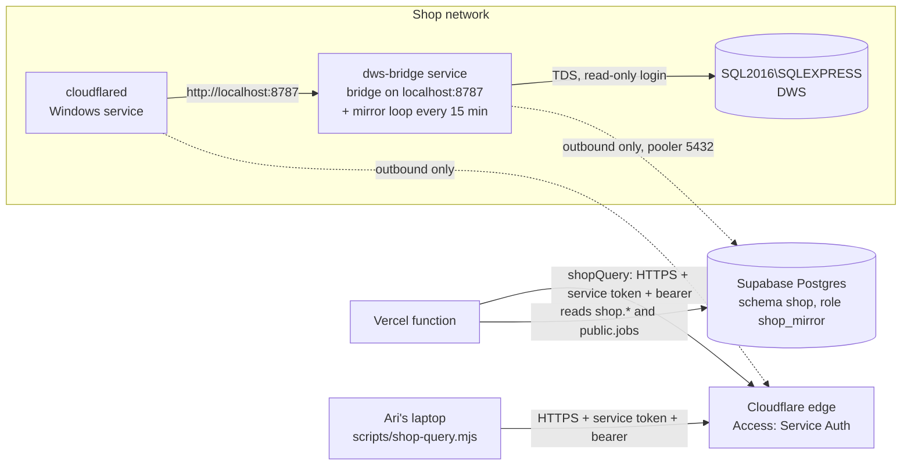

# Shop database bridge and mirror: read the on-prem SQL Server from the web apps

Shape: recommendation + tech spec + implementation plan. Ari's words are in
[`sources/ticket.md`](sources/ticket.md); the codebase facts in
[`sources/research-app.md`](sources/research-app.md) and
[`sources/research-conventions.md`](sources/research-conventions.md) (commit `f32010b`,
tip of `main` at authoring); the shop database facts in
[`sources/research-shop-db.md`](sources/research-shop-db.md) (from the `dwsTables`
catalog, data as of Jan 2024); vendor facts in
[`sources/research-external.md`](sources/research-external.md).
**Consequence: consequential** (a new always-on runtime in the shop, a copy of office
tables in Supabase, and the web apps reading the office database). **Delivery: gated**
(the apps change nothing until the new env vars and the `shop` schema exist).

**Agent brief.** Intent: give the DWS web apps (receipts and photos, Next.js on Vercel in
`cle1`, Supabase Postgres `qebbmojnqzwwdpkhuyyd`) read access to the shop's on-prem SQL
Server Express two ways: a live read-only query path for ad-hoc use, and a 15-minute
mirror of chosen tables in Postgres for the apps. No inbound hole in the shop network.
Source of truth: this plan, then the ticket, then the research. Locked decisions:
Decisions 1–24 below. Current phase: **Built on branch `shop-db-bridge` (2026-10-17), then narrowed to a statement file after the admin meeting (2026-10-22, decisions 17–20); Phase 0 items 2, 4, 5, the admin's statements, the production migrations, and the shop install (Phase 3) are Ari's.**
Stop-and-ask triggers: anything run against the shop's SQL Server or the production
Supabase project (including migrations); creating or changing a Cloudflare account,
zone, or token; any production env var. Everything else (file layout, helper names,
test fixtures) is implementation-owned.

## Words

- **Shop server**: the Windows host `SQL2016` running SQL Server Express (named instance
  `SQL2016\SQLEXPRESS`), live database `DWS`. Microsoft Access on office workstations
  links to it over the office network with Windows login. Sage MAS 90 lives on the same
  host. (`sources/research-shop-db.md` § 1)
- **Bridge box**: the always-on Windows computer Ari will set up in the shop.
- **Bridge**: the small read-only HTTP query service this plan adds on the bridge box,
  reached from the internet only through a Cloudflare Tunnel.
- **Mirror**: the copy of chosen shop tables in a `shop` schema in Supabase Postgres,
  refreshed every 15 minutes by the same service on the bridge box.

## Recommendation, in plain terms

One Node service on the bridge box does two jobs:

1. **The bridge.** It runs only the statements listed in `queries.json` on the box, which
   the shop's admin writes or approves, on the shop server with a read-only login, and
   returns rows as JSON. A Cloudflare Tunnel publishes it with no inbound port, and a
   Cloudflare Access service token in front stops anything without the token at
   Cloudflare's edge. The apps call a named statement with `shopQuery(name, params)`; Ari
   calls it from the laptop with one command.
2. **The mirror.** Every 15 minutes it reads each table on a short list from the shop
   server and replaces the copy in Supabase's `shop` schema in one transaction. The apps
   read the mirror like any other Postgres table. After each run a SQL function refreshes
   `public.jobs` from the mirrored project tables, so the jobs list stays current without
   a CSV.

Why both: the mirror is what the apps use day to day (fast, no dependence on the shop
being online at request time). The bridge serves named live reads and reports health.
Adding a table to the mirror is one `mirror` entry in `queries.json`, agreed with the
admin (Decision 17).

Why the mirror is pushed from the shop box and not pulled by Vercel: the Vercel Hobby
plan runs crons once a day, and Ari wants 15 minutes.

Options compared:

| Option | What it is | Verdict |
|---|---|---|
| **A. Bridge behind Cloudflare Tunnel + mirror pushed from the box (pick)** | Live read path plus a scheduled Postgres copy | Agnostic, one service to maintain, no inbound port, two auth layers, good DX. Ari's pick. |
| B. Mirror only | The push service alone; no Cloudflare, no domain | Simplest possible. Loses live ad-hoc reads; every new question is a config change and a 15-minute wait. Ari chose A over this. |
| C. Bridge behind Tailscale Funnel | Same bridge on a `*.ts.net` name | No domain needed, but Vercel cannot join a tailnet, so the endpoint is public and the bridge's own token is the only lock. Fallback if Cloudflare becomes a problem. |
| D. Postgres foreign tables ("remote columns") | Supabase's SQL Server wrapper | Needs the shop server reachable from the public internet. Ruled out. |

Security, layer by layer:

1. No inbound port: `cloudflared` dials out; the mirror dials out to Supabase; nothing dials in.
2. Cloudflare Access with a **Service Auth** policy: no token, no entry, and no log line in the shop.
3. The bridge checks its own bearer token too, so a mis-set tunnel still fails closed.
4. The shop database login is read-only (`db_datareader` plus `db_denydatawriter`).
5. The bridge runs only the statements in `queries.json`, each checked by a keyword
   filter at startup, with a 30-second deadline and a row cap.
6. The Supabase credential on the bridge box is a dedicated Postgres role, `shop_mirror`,
   that can write only the `shop` schema, upsert `public.jobs`, and call one function. It cannot read receipts,
   photos, or users. The box never holds the service-role key.
7. Every bridge query and every mirror run is logged.

Maintenance: two Windows services that start at boot (`cloudflared` and the bridge),
one `.env` file on the box, one `queries.json` listing every statement, four secrets in
Vercel, one document with exact commands and a token-rotation checklist.

Cost: Cloudflare Zero Trust free tier; the tunnel is free; a throwaway domain registered
in Cloudflare, about $10 a year.

## Why

The apps already carry office data by hand: `public.jobs` was loaded once from CSV
exports of `tblProject` and `tblMas90JobMasterOpen` by `dws-app/scripts/import-jobs.mjs`,
and nothing refreshes it (`sources/research-app.md` § 1). Employees are onboarded by
script from a CSV (`onboard-users.mjs`). Three plans and the runbook defer "the office
database bridge" (`sources/research-conventions.md` § 5). Ari wants a general read
capability, with a Postgres mirror of specific tables as the everyday path.

## Goals

- Server-side code in `dws-app` can run the bridge's named read-only statements on the live `DWS` database.
- The same from Ari's laptop with one command.
- A `shop` schema in Supabase holds a copy of the listed tables, at most 15 minutes old,
  replaced atomically so readers never see a half-copied table.
- `public.jobs` refreshes from the mirror after every run.
- Adding a table to the mirror is one `mirror` entry in `queries.json`.
- No inbound port or public IP at the shop; the shop box holds only least-privilege credentials.
- Setup and recovery documented so Ari can do both alone.

## Non-goals

- Writes to the shop database.
- Querying Sage MAS 90 directly. `tblMas90JobMasterOpen` and the `vewMas90*` views are
  the Sage window.
- Replacing Access, or moving the shop database.
- Changing how the apps read `jobs` today; they keep reading `public.jobs`.
- Syncing employees into Supabase Auth. `tblContact` is mirrored; what onboarding does
  with it is a later plan.
- Incremental (changed-rows-only) sync. The source has no reliable modified-at columns,
  and the listed tables are small, so each run copies whole tables.

## System sketch

## Premise anchors

| Anchor | Revalidation probe |
|---|---|
| Access reaches the shop server over the network with Windows login, so the instance accepts network connections already | On a workstation: Access → linked table properties show `SERVER=SQL2016\SQLEXPRESS;Trusted_Connection=Yes;DATABASE=DWS` |
| Vercel Hobby crons run once a day | `Docs/photos-runbook.md` "Hobby plan allows one region"; Vercel cron docs in `sources/research-external.md` |
| `jobs` writes are service-role only; `synced_at` marks imported rows | `rg -n 'synced_at' dws-app/scripts/import-jobs.mjs dws-app/supabase/migrations` |
| Migrations are files applied with `supabase db query -f` before the deploy that needs them | `dws-app/supabase/migrations/README.md` |
| DNS for the production domain is at Vercel | `dig +short NS design-workshops.app` |
| The listed source tables are small | `sources/research-shop-db.md` § 2–3, § 6: `tblContact` 5,066 rows, `tblProject` 1,809, `tblLocation` 668, `tblHardware` 79, `tblMas90JobMasterOpen` 35 |

## Decisions

| Decision | Warrant | Reversal condition |
|---|---|---|
| 1. HTTP query service, not the raw SQL port, behind the tunnel | Vercel functions cannot run `cloudflared`, which raw TCP through a tunnel requires | None expected |
| 2. ~~The bridge accepts arbitrary single `SELECT`s~~ Superseded 2026-10-22 by 17: the bridge runs only statements listed in `queries.json` on the box (mirror entries and named live queries, the latter empty today); the keyword guard, timeout and row cap still apply to every listed statement | The shop's admin asked for the specific queries rather than open query rights; the apps need no ad-hoc reads today | Reopen ad-hoc `SELECT`s only with the admin's agreement |
| 3. Bridge and mirror run on the bridge box, not on the shop server | Ari's stated setup; keeps new software off the machine that runs the business | Move onto the shop server if the admin prefers |
| 4. Plain Node (`.mjs`), dependencies `mssql` and `pg` only, built-in `http`, no build step | Smallest thing to install and debug on Windows; one language with the rest of the repo | None expected |
| 5. Two auth layers on the bridge (Cloudflare service token at the edge, bearer inside) | Cheap; survives either side being misconfigured | None expected |
| 6. Bridge binds to `127.0.0.1`; `cloudflared` on the same box is its only client | No LAN exposure of the HTTP service | None expected |
| 7. Secrets on the box live in `C:\dws-bridge\.env`, NTFS-restricted to the service account and Administrators | Simplest thing that is not world-readable | Admin asks for Windows Credential Manager or a vault |
| 8. Windows services via NSSM (bridge) and `cloudflared service install` (tunnel), both start at boot | Survives reboots and crashes without a person | Task Scheduler "at startup" if NSSM is unwanted |
| 9. Tunnel hostname on a throwaway domain registered in Cloudflare | Production DNS is at Vercel; a separate domain touches nothing in production. Ari agreed 2026-10-17 | Move production DNS to Cloudflare later if wanted |
| 10. All shop data, phone numbers included, may leave the shop over TLS | Ari 2026-10-17: "all of this can leave the shop" | — |
| 11. The mirror is pushed from the bridge box every 15 minutes, in the same service as the bridge | Vercel Hobby crons are daily; one service is one thing to install and watch | Pull from a Vercel cron if the plan becomes Pro and the box is unwanted |
| 12. Each mirrored table is replaced whole, inside one Postgres transaction, over a direct `pg` connection to the session pooler | No reliable modified-at columns in the source; tables are small; a transaction means readers never see a half-copied table | Incremental sync for a large table if one is ever added |
| 13. The box holds a dedicated Postgres role `shop_mirror` with rights only on the `shop` schema and `execute` on `shop.refresh_jobs()` | Least privilege; the box never holds the service-role key | — |
| 14. ~~Mirror table DDL is generated into a migration file~~ Superseded 2026-10-22 by 18: the service creates each landing table (`shop.<into>`, all columns nullable, no PK) from the statement's result set on first run, and stops that entry with a clear error if the shape later differs; it never drops or alters | The admin authors the statements, so their shape is not known when migrations are written | Return to committed DDL if the admin wants the landing shape reviewed in the repo |
| 15. `public.jobs` refresh runs in SQL (`shop.refresh_jobs()`) after each mirror run, mirrors `import-jobs.mjs`'s rules, and never deactivates | Pure SQL is testable in `test:db`; deactivation hides photos and the runbook calls it undecided | Decide deactivation after a few weeks of "dropped from open" logs |
| 16. A new runtime is being added (the hosted-MCP plan asks before this) | Ari asked for it explicitly in the ticket | — |
| 17. Least privilege by a statement file: `queries.json` on the box is the complete list of SQL the service can run; the admin writes or approves every line; the shipped statements are suggestions with the needed columns named | Ari 2026-10-22, after meeting the admin: limit the bridge to what the receipts and photos apps need now and build trust; "she can write the queries" | Add statements only by agreement with the admin |
| 18. Landing tables are created by the service from the result set (see 14); the Supabase migrations ship only the schema, the role, `sync_runs`, `refresh_jobs()`, and the status function | Follows from 17 | As 14 |
| 19. Mirror set is `projects`, `locations`, `open_jobs`, `contacts` (all rows of `tblContact`, 10 columns); `tblHardware` dropped | Ari 2026-10-22: all contacts, because only a person who exists as a DWS contact may register an account (employees now, architects and contractors later); hardware is not used by any app | Add a table only by agreement with the admin |
| 20. One document, `shop-bridge/README.md`, for developer, admin, and future maintainer; shared with the admin as a secret gist rather than the repository | Ari 2026-10-22: do not point the admin at the whole repository; one neutral document instead of a runbook plus an admin explainer | Move to the service's own repository when it gets one |
| 21. `shop.refresh_jobs()` runs with the caller's rights (security invoker); `shop_mirror` gets `select, insert, update` on `public.jobs` and a narrow RLS policy there, and nothing else in `public` | Independent review 2026-10-22: with a definer function reading tables the mirror role owns, the role could replace a landing table with a view calling its own function and have it run as `postgres`. Invoker rights make the role's grants the ceiling | — |
| 22. The mirror verifies Supabase's TLS certificate against Supabase's root CA shipped as `shop-bridge/supabase-ca.crt`; URL ssl options are ignored | The pooler's certificate chains to `Supabase Root 2021 CA` (valid to 2031), not a public root, verified with openssl 2026-10-22; without the CA the connection was encrypted but unauthenticated | Re-ship the file when Supabase rotates its CA |
| 23. The service runs under the virtual account `NT SERVICE\dws-bridge`; `NetworkService` is the documented fallback | `NetworkService` is shared by many services, all of which could read `.env`; the account is set with `sc.exe config ... obj=` because the NSSM 2.24 download predates virtual-account support | Fall back if the box rejects the account |
| 24. The guard is described as a conservative keyword filter, extended with transaction, session, control-flow and lock-hint words; every statement runs under a 30-second wall-clock deadline and the mirror stops reading at the row cap | Both reviews: T-SQL needs no `;` between statements, so "one SELECT" was not enforced; tedious's requestTimeout only covers the first packet; the cap was checked after buffering | A real T-SQL parser if the filter ever has to prove single-statement |

## Alternatives considered

- **Free single-`SELECT` queries instead of a statement file.** The first design; the
  shop's admin asked for the specific queries instead (Decision 17).
- **Mirror via `supabase-js` upserts with the service-role key.** Familiar in this repo,
  but REST cannot do a transactional replace, and the box would hold the key to everything.
- **Mirror pulled by a Vercel cron through the bridge.** Daily only on Hobby.
- **Python service.** Fine too, but the repo is TypeScript/Node and Ari maintains it.
- **Supabase's SQL Server wrapper.** Needs public reachability. Ruled out.

## Contract surface

Decisions 17–24 replaced the first design (ad-hoc `POST /query`, `mirror.config.json`,
generated table DDL). What is built:

- **Bridge and mirror** (`shop-bridge/`): routes, settings, limits, rejections, and files
  are in [`shop-bridge/README.md` § 9 Reference](../../../shop-bridge/README.md). The
  service runs only the statements in `queries.json`: `mirror` entries `{ into, sql }`
  copied into `shop.<into>` every `SHOP_MIRROR_INTERVAL_MINUTES`, and named `live`
  statements served at `POST /query/<name>` (none shipped).
- **Supabase side**: the three `dws-app/supabase/migrations/20261017100*_shop_*.sql`
  files. `shop` schema; role `shop_mirror` with `usage, create` on `shop` (it owns the
  landing tables it creates), `execute` on `shop.refresh_jobs()`, and `select, insert,
  update` plus its own policy on `public.jobs`; `shop.sync_runs`; and
  `public.shop_sync_status()` for the admin (service role only).
- **`shop.refresh_jobs()`**, `security invoker`, callable only by `shop_mirror`: upserts
  into `public.jobs` from `shop.projects` joined to `shop.open_jobs` (`JobStatus = 'O'`,
  `Completed IS NULL`, `Archived = false`) and `shop.locations` for the location text;
  sets `name`, `location`, `is_active = true`, `synced_at = now()`; skips numbers held by
  trashed rows; never touches `P-` rows; never sets `is_active = false`; returns
  `{ ok, upserted, skipped_trashed, dropped_from_open }` and writes it to `sync_runs`
  under `table_name = 'public.jobs'`. On failure it records an `ok = false` row and returns
  `{ ok: false, error }` instead of raising (raising would roll back the failure row); the
  mirror reads that flag. Location text is `coalesce(LocationName, "LocationAddress, LocationCity")`.
- **App client** (`dws-app/src/lib/shop/query.ts`, server-only): `shopQuery(name, params?,
  { maxRows?, timeoutMs? })` → rows, `shopQueryResult` for the full result, and
  `shopHealth()`. Env in Vercel: `SHOP_BRIDGE_URL`, `SHOP_BRIDGE_TOKEN`,
  `CF_ACCESS_CLIENT_ID`, `CF_ACCESS_CLIENT_SECRET`, none prefixed `NEXT_PUBLIC_`. CLI:
  `node --env-file=.env.local scripts/shop-query.mjs --health` or `<name> [--param k=v]`.
  `GET /api/shop/health` behind `requireAdmin()` returns bridge health plus
  `public.shop_sync_status()`.

### Acceptance criteria

- **AC-1 Outbound only.** No new inbound firewall rule or port forward on the bridge box.
- **AC-2 Edge auth.** A request to the tunnel hostname without the Cloudflare service
  token is rejected by Cloudflare and leaves no line in the bridge log.
- **AC-3 Bridge auth.** A request with the service token but a wrong bearer gets `401`.
- **AC-4 Read-only at the source.** As the bridge's SQL login, `INSERT` and `UPDATE` fail
  with a permission error; the bridge returns `400` for non-`SELECT` input before any DB call.
- **AC-5 Bounded.** A query over `maxRows` returns `truncated: true`; a query past 30 s
  returns `504` and releases its connection.
- **AC-6 Works from production.** `shopQuery('select 1 as ok')` from a Vercel function
  in `cle1` returns `[{ ok: 1 }]`.
- **AC-7 Works from a laptop.** The CLI runs the same query with the same env.
- **AC-8 Survives restarts.** After rebooting the bridge box, both services run and
  `/health` passes; after SQL Server restarts, the next query and the next mirror run succeed.
- **AC-9 Mirror is whole and fresh.** For each configured table, `count(*)` in `shop`
  equals the source count at the same moment, the newest `sync_runs` row is under 15
  minutes old, and a reader during a run never sees an empty or partial table.
- **AC-10 Least privilege in Supabase.** As `shop_mirror`, `select` on `public.photos`,
  `public.user_profiles`, and `public.receipts` fails; `insert` into `shop."tblProject"` succeeds.
- **AC-11 Jobs refresh.** After a run, open office jobs exist in `public.jobs` with
  `synced_at` set; no row was set `is_active = false`; `P-` rows and trashed rows are untouched;
  `sync_runs` holds the dropped-from-open list.
- **AC-12 Adding a table.** Adding a name to `mirror.config.json`, running the DDL script,
  applying the migration, and restarting the service yields the new table in `shop` on the
  next run, with no code change.
- **AC-13 Documented.** The runbook covers setup, the env tables (box and Vercel),
  rotating the Access token, the bearer, and the `shop_mirror` password, adding a table,
  and recovery when the tunnel, the bridge, the mirror, or SQL Server is down.

## Phase 0 — Decisions and shop prerequisites (Ari and the admin; no code)

Settles the facts the code depends on.

### Steps
1. Settled 2026-10-17: option A; 15-minute mirror; throwaway domain in Cloudflare; all
   data may leave the shop; the bridge box is a separate Windows machine.
2. **Login type** (open): the admin runs `SELECT SERVERPROPERTY('IsIntegratedSecurityOnly')`.
   `0` → create SQL login `dws_bridge_ro` with `db_datareader` and `db_denydatawriter` on
   `DWS`. `1` → create a Windows account for the service; it will use NTLM. Turning on
   mixed mode needs a SQL Server restart, so prefer whichever needs no restart.
3. Ari registers the throwaway domain in a Cloudflare account (or confirms one exists).
4. **SQL Server version** (open): `SELECT @@VERSION`. If 2016, note extended support ended
   July 2026; not blocking.
5. **Admin** (open): who creates the login and, if needed, the service account.
6. From the bridge box, with the chosen login: `sqlcmd -S SQL2016\SQLEXPRESS -d DWS -Q "select 1"`.

### Verify
- [ ] Items 2, 4, 5 recorded here under Decisions.
- [ ] `sqlcmd` from the bridge box returns `1`.

### Exit criteria
Login type, version, and admin are recorded; the bridge box can reach the instance.

## Phase 1 — The service: bridge and mirror (local, no shop access)

Establishes the service and its guards with tests, before any shop setup.

### Steps
1. `shop-bridge/server.mjs`: `http` server on `127.0.0.1`; `mssql` pool; `/health` and
   `/query`; bearer check with `timingSafeEqual`; statement guard as a pure function in
   `shop-bridge/guard.mjs`.
2. `shop-bridge/mirror.mjs`: the loop (`setInterval` with an in-flight flag), per-table
   read, transactional replace through `pg`, `sync_runs` write, `refresh_jobs()` call;
   `shop-bridge/types.mjs` with the type map shared by the DDL script.
3. `shop-bridge/mirror.config.json` with the five tables. `package.json` with `mssql` and
   `pg`; `npm test`.
4. Tests: `guard.test.mjs` (accepts `select`/`with`; rejects `;`, write keywords,
   `select ... into`, keywords hidden in comments); `server.test.mjs` with a stub pool
   (auth, size limit, truncation, timeout mapping); `mirror.test.mjs` with stub drivers
   (one table fails → others commit, run recorded, overlap skipped).
5. Integration: SQL Server container (`mcr.microsoft.com/mssql/server:2022-latest`; on
   Apple Silicon enable Rosetta in Docker Desktop) plus the repo's Postgres test harness.
   If the SQL Server container will not run on the Mac, run that test on the bridge box in
   Phase 3 and say so.
6. `shop-bridge/README.md`: what it is, env table, how to run locally.

### Verify
- [x] [AC-3, AC-4, AC-5] `npm --prefix shop-bridge test` green (67 tests, 2026-10-17).
- [ ] [AC-9] Integration: the five tables copy from the container into a local `shop`
      schema; counts match; a concurrent reader mid-run sees the old full table.
- [ ] Integration: an `INSERT` through `/query` is refused with `400`.

### Exit criteria
The service runs locally against containers with every guard and the mirror proven by tests.

## Phase 2 — Supabase side

Establishes the `shop` schema, the least-privilege role, and the jobs refresh.

### Steps
1. Migration `<ts>_shop_schema.sql`: schema, grants, `shop_mirror` role (no password in
   the file), `sync_runs`.
2. The DDL generator (`shop-bridge/ddl.mjs`, exposed as `GET /ddl`; until the bridge is
   live, a `--from-catalog <dwsTables metadata columns.csv>` option generates from the
   catalog). Generate `<ts>_shop_tables.sql` for the five tables; review by hand against
   `sources/research-shop-db.md` § 2–3.
3. Migration `<ts>_shop_refresh_jobs.sql`: `shop.refresh_jobs()` per § Contract surface.
   Decide the location text column by comparing five current `jobs.location` values with
   `tblLocation` fields (read-only query on production, Ari confirms first).
4. `test:db` cases: role boundaries (AC-10); `refresh_jobs()` rules (AC-11) with fixtures
   for a trashed number, a `P-` row, a renamed imported job, and a job that left the open set.
5. Apply the three migrations to production (Ari confirms), then set the `shop_mirror`
   password with `alter role` out of band and record where it is kept.

### Verify
- [x] [AC-10, AC-11] `npm --prefix dws-app run test:db` green for the new cases (6 tests in `integration/db/shop.test.ts`, 2026-10-17).
- [ ] Migrations applied to production; `select count(*) from shop.sync_runs` returns `0`.

### Exit criteria
Production has an empty `shop` schema, the role, and the refresh function, and nothing
else changed.

## Phase 3 — Shop install (the bridge box)

Establishes the running service in the shop and the tunnel in front of it.

### Steps
1. `shop-bridge/install/setup.ps1`: creates `C:\dws-bridge`, copies the service and
   config, writes `.env` from prompts (never echoing secrets), restricts the folder ACL,
   installs the service with NSSM (stdout to `C:\dws-bridge\logs\`), starts it, and
   checks `http://127.0.0.1:8787/health`.
2. Cloudflare: create the tunnel in Zero Trust, install `cloudflared` as a Windows service
   with the tunnel token, add the public hostname → `http://localhost:8787`, create a
   self-hosted Access application for it, a service token `vercel-dws` (longest duration
   offered; expiry noted in the runbook), and a Service Auth policy allowing only that token.
3. Prove from Ari's laptop: no token → blocked by Cloudflare; token but wrong bearer →
   `401`; both → `/health` passes and `select top 5 ProjectID, Project from tblProject`
   returns rows.
4. Watch the first mirror run in the log; confirm `shop.sync_runs` has five `ok` rows and
   `public.jobs` gained `synced_at` values.
5. Reboot the bridge box; confirm both services came back and the next run happened.
6. `Docs/shop-bridge-runbook.md` per AC-13; add it to `Docs/_sidebar.md`.

### Verify
- [ ] [AC-1] Windows Firewall inbound rules unchanged; `cloudflared` service running.
- [ ] [AC-2, AC-3] The three laptop probes behave as listed; the no-token probe leaves no bridge log line.
- [ ] [AC-4] `sqlcmd` as the bridge login: an `insert`/`update` fails with a permission error.
- [ ] [AC-8, AC-9] After reboot, `/health` passes and a fresh `sync_runs` row appears within 15 minutes.
- [ ] [AC-13] Runbook present and followed once end to end by Ari.

### Exit criteria
The mirror refreshes on its own every 15 minutes; a laptop with the two secrets can
query the live `DWS` database through the tunnel; nothing else can.

## Phase 4 — App client, CLI, and health

Establishes the developer experience in the repo and proves it from production.

### Steps
1. `dws-app/src/lib/shop/query.ts` (`server-only`): `shopQuery`, `shopHealth`; fetch with
   the four headers, 20 s `AbortSignal.timeout`, errors mapped to a `ShopBridgeError`.
2. `dws-app/scripts/shop-query.mjs`: the CLI.
3. `GET /api/shop/health` behind `requireAdmin()`: bridge health plus latest `sync_runs` per table.
4. Vercel env: the four variables, production and preview; `Docs/Configuration.md` updated.
5. Unit tests with mocked `fetch`; a route test for the health route.
6. Mark `dws-app/scripts/import-jobs.mjs` as the manual fallback in its header comment and
   in `Docs/photos-runbook.md` § hand-made projects.

### Verify
- [ ] [AC-6] On production, `GET /api/shop/health` as an admin reports `ok: true` and
      five fresh `sync_runs` rows; the route's log shows `shopQuery('select 1 as ok')` → `[{ ok: 1 }]`.
- [ ] [AC-7] `node --env-file=.env.local scripts/shop-query.mjs "select top 3 ProjectID, Project from tblProject order by ProjectID desc"` prints three rows.
- [ ] [AC-12] Add `tblPM` to the config, run the DDL script, apply, restart: `shop."tblPM"` fills on the next run.
- [x] `npm --prefix dws-app test` and `tsc --noEmit` clean (986 tests, 2026-10-17).

### Exit criteria
Any server-side code can call `shopQuery` or read `shop.*`; Ari can explore from the
laptop; the admin health route shows the mirror's age.

## Rollout

Branch `shop-db-bridge` off `main` (`f32010b`), kept linear. One PR for Phases 1, 2, and
4 (code, migrations, docs); Phase 3 happens in the shop between the migrations being
applied and the Vercel env vars being set. Nothing in the apps changes behaviour until
the env vars and the `shop` schema exist, so the PR can merge before the shop install.
Order on the day: apply migrations → install the box → confirm the first run → set
Vercel env → confirm the health route.

## Risks

- **Shop internet or power outage.** The mirror goes stale and the bridge is unreachable;
  the apps keep working on the last copy. The health route shows the age.
- **SQL Server Express limits** (4 cores, 1.4 GB buffer): four column-listed statements every
  15 minutes is light; the bridge's deadline, row cap, and pool of 4 bound every statement.
- **A table grows.** `tblTimesheet` (289k rows) would not suit a whole-table copy every 15
  minutes; the config keeps it out, and Decision 12 names the incremental path if needed.
- **Token or password leakage.** Each credential is scoped (edge token, bearer,
  `shop_mirror`, `dws_bridge_ro`); rotation is in the runbook.
- **Windows Update reboots.** Both services start at boot (AC-8).
- **The Sage link "goes to sleep"** (known in the shop). The mirror reads the SQL Server
  copy `tblMas90JobMasterOpen`, not Sage; staleness shows as a stable open list and is a
  shop-side fix.
- **Self-signed certificate on the instance.** `SHOP_DB_TRUST_CERT=true` on the LAN hop;
  both internet hops are TLS.
- **Access token expiry.** The runbook records the date; the health route surfaces a `403`
  from the edge as "office database: blocked".
- **Schema drift at the source.** Statements list their columns, so a new column in SQL
  Server is not copied until a statement names it; a statement whose result no longer
  matches its landing table fails that entry, recorded in `sync_runs` (Decision 14).

## Open questions

- Phase 0 items 2, 4, 5.
- Whether the live `DWS` schema differs from the Jan 2024 export the research used.
- Deactivating closed jobs in `public.jobs`: deferred until the dropped-from-open lists
  have a few weeks of history.
- What onboarding should do with mirrored `tblContact` rows: a later plan.
- Raised by the admin and out of this plan's scope: photo and receipt storage buckets are
  public, so any object URL once seen works forever regardless of share-link state; needs
  its own plan (private buckets plus signed URLs), followed by a security audit.

## Relationship to other plans

- `plans/active/photo-folders/plan.md` and `Docs/photos-runbook.md` § hand-made projects:
  the office bridge they defer. Decision 15 keeps their rule that `P-` rows are never
  touched and that reconciliation stays undecided for now.
- `plans/active/dws-hosted-mcp/plan.md`: the stop-and-ask on "another runtime" is
  answered here by the ticket.

## Build notes (2026-10-17)

- `jobs.location` today: `import-jobs.mjs` stored `tblProject.Location`, which is the
  `tblLocation` id, so production values are probably bare numbers. The first refresh
  replaces them with `LocationName` for every open job. Not checked against production.
- Phase 1 step 5 (SQL Server container test) was not run; the first real SQL Server
  contact is the shop install. The Windows scripts were not executed (no PowerShell here).

## Scope change (2026-10-22)

After Ari met the shop's database admin: she is open to the setup, wants to see the
specific queries rather than grant open query rights, and will write or approve them.
Rework on branch `shop-db-bridge`:

- `shop-bridge/queries.json` replaces `mirror.config.json`; ad-hoc `POST /query` and
  `GET /ddl` are gone; `POST /query/<name>` runs a named `live` statement (none shipped).
- Landing tables `shop.projects`, `shop.locations`, `shop.open_jobs`, `shop.contacts`
  are created by the service; the `shop_tables` migration is deleted and
  `refresh_jobs()` reads the new names.
- `shop-bridge/README.md` is the single document; the two `Docs/` pages collapse into a
  pointer. The admin gets it, with the code, as a secret gist.
- Still Ari's: the admin's account in the apps (phone number pending), the login,
  Phase 0 answers, migrations, shop install.
- The admin also raised the public storage buckets (see Open questions).

## Review round two (2026-10-22)

Two delegated reviews of `8994378`: a sealed, independent Codex review and a Claude
review. Both said "not ready to show the admin" and named one thing each: the
definer-rights escalation (decision 21) and the keyword filter's gap (decision 24). The
rest: client-side Postgres deadlines (a dead socket left the mirror "in flight" forever),
a malformed request URL could exit the process, the installer's health check matched the
wrong `ok`, the `.env` ACL was shared with every NetworkService process, `SHOP_DB_NAME` was
not enforced, dates and decimals beyond the driver's precision, and a dozen readability
cuts. All applied on the branch; the README's "about 1,000 lines" matches the code.

